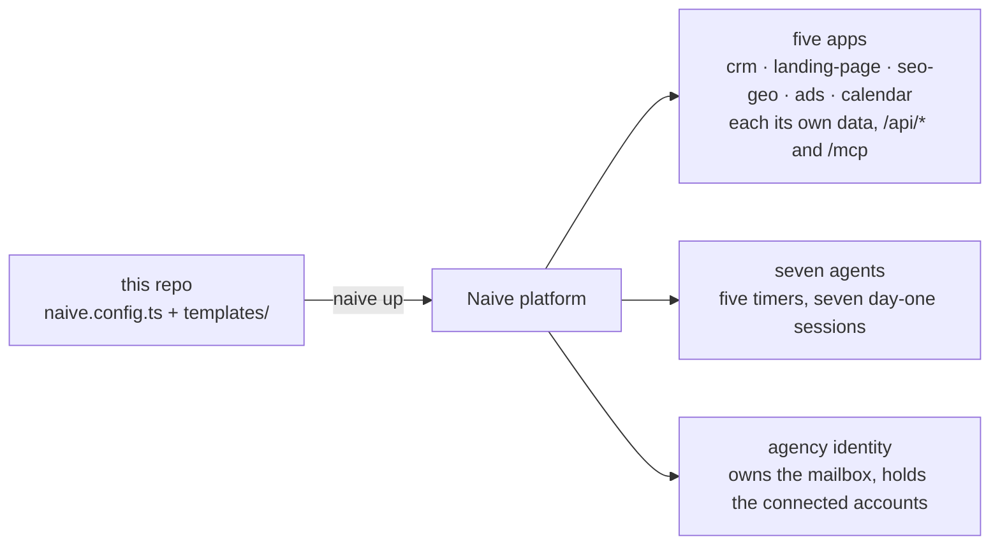

# 🏢 Agency Blueprint

**An entire agency in one repository — clone it, run `naive up`, and the Naive platform
provisions the agency's apps and its crew of agents into your own organization.**

[](LICENSE)
[](https://www.npmjs.com/package/@usenaive-sdk/blueprints)
[](https://www.npmjs.com/package/@usenaive-sdk/vetta-cli)
[](https://nodejs.org)
[](https://react.dev)

A template is **agents plus apps**, nothing else (ADR-1766). This repo ships five primitive
apps — **CRM**, **Landing page**, **SEO & GEO**, **Ads** and **Calendar** — each deployed on its own with its
own data and its own MCP tools, and a crew of seven agents that read the three answers you give
at install and start work the same day. There is no agency dashboard: the Studio
(app.usenaive.ai) draws the company — Home, approvals, agents, chat — and each app opens from
its Apps rail.

It comes in **six templates**: `blank`, a working agency with no specialism, and five
specialisms of it — `recruiting` (role briefs, shortlists, screening and outreach), `seo-geo` (search and answer-engine work), `market-research` (sizing,
competitor teardowns, customer insight), `advertising` (paid campaigns and the creative to run in them) and `security` (customer-journey and edge-case testing of clients' live products).
One repo carries all six — see [The templates](#-the-templates).

The engine is [`@usenaive-sdk/blueprints`](https://www.npmjs.com/package/@usenaive-sdk/blueprints),
installed from the public npm registry like any other dependency. Nothing here resolves out
of a private workspace: a clone plus `pnpm install` is the whole toolchain.

## 🗺 What `naive up` provisions



- **Five apps**, one per id in the template's `apps` (`templates/index.ts`). Each is this repo's
  one build deployed on its own and told which it is by `APP_ID`, so each has its own database
  and serves only its own screen, routes and tools:

  | App | Owns | Its agents' tools |
  |---|---|---|
  | `crm` (required) | clients and the pipeline, notes, referrals, onboarding, and work whose kind names no other app (research and QA reports) | `crm.list_clients`, `crm.create_lead`, `crm.get_client_crew`, `crm.record_onboarding`, … |
  | `landing-page` | the public site at `/` (its copy is a `site_profile` record), the agency's own blog, and the contact form's lead inbox | `landing-page.get_site`, `landing-page.update_site*`, `landing-page.list_new_leads`, … |
  | `seo-geo` | search work for clients (pages, articles, answer blocks, ranking reports, audits) and search measurement | `seo-geo.list_posts`, `seo-geo.create_draft_post`, … |
  | `ads` | ad work for clients (audits, campaign plans, briefs, concepts, copy, statics, video, performance reports) and the ad accounts | `ads.list_posts`, `ads.create_draft_post`, … |
  | `calendar` | client meetings and the day each deliverable is due (pointing at the app that holds it) | `calendar.list_events`, `calendar.create_event`, `calendar.update_event` |

  **Apps never call each other.** No app knows another's address; agents carry data between
  them. A visitor's message lands in the landing page's inbox, and the `sales` agent files it
  into the CRM on its next run (`landing-page.list_new_leads` → `crm.create_lead` →
  `landing-page.mark_lead_filed`). **No app can write to the platform**: each holds the read key
  the platform mints it, so none can create an agent, send or publish.
- **Seven agents** — the active template's crew, each with a role, a private system prompt,
  a deny-by-default tool allow-list, skills from the platform catalogue, a daily budget, and a
  first message that runs on day one. See [The crew](#-the-crew).
- **The agency identity** (`agency`) — the persona every agent and every schedule acts as. It
  is what owns the agency mailbox and holds any connected account.

That persona is not decoration: identity tools resolve `session → agent → identity →
{inboxes, connected accounts}`, so an agent holding no persona is offered nothing at all from
a mailbox or a connected account, and a scheduled fire without one runs as nobody. It is declared once in
[`naive.config.ts`](naive.config.ts); the schedules name it and a real time zone
([`templates/blank.ts`](templates/blank.ts)), because an omitted zone is UTC by the
platform's default and 08:00 UTC is nobody's Monday morning.

A template may also declare a **per-client team**, hired when you onboard a client — their names
carry the client's slug, so they cannot be declared in `naive.config.ts`. Moving a client to
active in the CRM opens a CEO chat with the request typed; the CEO reads `crm.get_client_crew`
(each seat named `<seat>--<slug>`, a browser locked to the client's own domain, seats it
already has listed so none is hired twice), hires each with an approval card you answer, and
calls `crm.record_onboarding`. `seo-geo` declares three (`seo-writer--<slug>`,
`geo-optimizer--<slug>`, `audit-runner--<slug>`); `blank` declares none and runs every client
through the agency's own seven.

## 👥 The crew

Both templates share the core seven; `seo-geo` adds a read-only paid-media planner, appends a
sentence of search focus to each shared prompt, and adds search skills to the relevant lists. Every prompt opens
with the same paragraph: read `project_context` before anything else — it holds your setup
answers in your own words — and treat those answers as the client's, never yours to invent.
Tools marked `*` are held at `ask` and land on **Approvals** before they run.

| Agent | Role | Tools | Skills | Timer (`America/New_York`) | First message (day one) |
|---|---|---|---|---|---|
| `site-builder` | Public site | `web_fetch`, `landing-page.get_site`, `landing-page.update_site*` | `naive/landing-page-copy` | — | Reads the site and rewrites every generic section from the answers; proposes it as one `update_site` call. Invents no case study, testimonial or number. |
| `sales` | Pipeline | `web_search`, `web_fetch`, `crm.{list_clients, get_client, create_lead, add_client_note, advance_pipeline}`, `landing-page.{list_new_leads, mark_lead_filed}`, `email.inboxes`, `email.read`, `email.send*`, `send_to_agent`, `list_agents` | `naive/cold-outreach-drafting`, `naive/crm-hygiene` | weekdays 08:30 | Fifteen prospects matching the ideal-client answer, filed as leads with a why-now; openers drafted (not sent) for the best three. |
| `client-manager` | Delivery | `crm.{list_clients, get_client, create_lead, add_client_note, list_referral_ready, record_referral_ask}`, each app's `{get_calendar, list_posts, create_draft_post, schedule_post}`, `landing-page.get_site`, `email.inboxes`, `email.read`, `email.send*` | `naive/client-onboarding` | Mon 08:00 | The onboarding checklist and a first-30-days calendar template for the service you sell. |
| `content-writer` | Content | `web_search`, `web_fetch`, `crm.{list_clients, get_client, create_lead, add_client_note}`, `landing-page.{list_posts, create_draft_post, get_site}` | `naive/seo-content-brief` (+ `naive/geo-answer-blocks` in `seo-geo`) | Tue + Thu 07:00 | A note on who the blog is for and its voice. The four-week calendar and first draft are written in the session the gap researcher's handoff opens. |
| `content-reviser` | Revisions | `web_fetch`, `crm.{list_clients, create_lead}`, `landing-page.{list_posts, create_draft_post, get_site}` | `naive/content-revision` | Wed 09:00 | Reads the site and every published post; files revisions for the three weakest as pending drafts. |
| `gap-researcher` | Research | `web_search`, `web_fetch`, `crm.{list_clients, create_lead, add_client_note}`, `landing-page.get_site`, `send_to_agent`, `list_agents` | `naive/keyword-gap-analysis` (+ `naive/geo-answer-blocks` in `seo-geo`) | Fri 09:00 | Three competitors compared against your site; the ten highest-value misses filed as a gap report, then handed to `content-writer`. |
| `proposal-writer` | Proposals | `web_fetch`, `crm.{list_clients, get_client, create_lead, add_client_note}` | `naive/proposal-writing` | — | The standard proposal skeleton and three package tiers — priced from the pricing answer when the template asked one (`blank`); `seo-geo` asks competitors instead, so its tiers are scoped without prices until the operator answers `ask_operator`. |
| `paid-media-planner` (`seo-geo`) | Paid media | `web_search`, `web_fetch`, CRM reads, `seo-geo` queue writes, read-only Google/Meta Ads tools | `naive/proposal-writing` | — | A zero-baseline plan with operator-selectable budget scenarios, integration-aware channels, measurement and stop rules. It cannot mutate campaigns or spend. |

Every agent also holds `project_context` and `read_skill` (`allow`) and the two doors to you,
`ask_operator*` and `request_tools*`. No agent holds `approve_post`, `start_agent_session` or
`social.post`: approving, spending and publishing stay with you.

### Setup questions

A template asks at most four questions before anything is provisioned, and the answers become
the project's context — what every agent reads first.

| | `blank` | `seo-geo` |
|---|---|---|
| public identity | — | Agency name, verified public inbox, and whether pricing is custom-scoped or hidden. |
| `offer` | What does your agency sell, and to whom? | What does your agency sell, and to whom? (search and answer-engine work) |
| `ideal_client` | Who is your ideal client — industry, size, geography? | same |
| third | `pricing` — How do you price — retainer / project / hourly — and your typical range? | `competitors` — Which three competitors do your clients lose to in search? |
| `network` (optional) | Who do you already know who might need this, or know someone who does? | — (four is the limit: `sales` asks this in its first session with `ask_operator`) |

The network answer is for the first client, when there's nobody yet to ask for a referral. On
day one `sales` files each person named as a `network` lead and drafts a short personal note to
each for approval. An empty answer skips it, and no contact is ever invented.

Cold openers show the work. In both templates `sales` reads the prospect's own site first and
names one specific thing it read there. In `seo-geo` it runs a short public audit before each
opener: what the prospect ranks for, whether AI answers cite it, and two or three concrete
fixes, filed as a note on the lead, with the opener quoting one finding. It reports no ranking,
citation or traffic figure it didn't see.

Edit an answer later through the platform (`PATCH /v1/blueprints/installs/{id}`); the crew
reads the new value on its next turn, no re-apply needed.

### Day one

Each of the seven carries an `intake` — a first message the apply starts a session with,
capped at **$20** (`20_000_000` µUSD) each. An intake runs *once*, on the apply that creates
the agent, and never again on a later apply, so seven of them are a one-off ceiling of
**$140** on install day — not a monthly line.

What recurs is the separate per-agent `budget`: **$60** a day each
(`cap_micro_usd: 60_000_000`, `period: "day"`), no more than $20 of it on any one task. That
is a ceiling, not a bill — nothing spends against it unless a timer fires or you start a
session, and the crew's declared timers are ten scheduled runs a week in all, each capped at
$10 per fire.

Day one leaves you: a rewritten site waiting on Approvals, fifteen leads, an onboarding
checklist, an editorial calendar and a first draft, three revisions, a gap report and a
proposal skeleton — all filed on the agency's own client record or as pending drafts, nothing
sent, nothing published. The Studio's Home shows each of those sessions and what it is
waiting on.

### Handoffs

The seven intakes open in the same minute, and two of them depend on another's output: the
content writer's calendar is written from the gap researcher's report, and a proposal is written
for a lead sales has advanced. Where one seat's work is another's input, the first **hands off**
to the second instead of both reading an empty record at once. Each `AgentDecl` declares the
platform's `handoffs` field — the names it may open a session on — and only those seats are
granted the two platform tools, `send_to_agent` and `list_agents`:

| Sender | `handoffs` | Hands on | The message names |
|---|---|---|---|
| `gap-researcher` | `["content-writer"]` | once the gap report is filed (day one, then every Friday) | the agency record's `cli_` id and the ten gaps |
| `sales` | `["proposal-writer"]` | when a lead is advanced to `proposal` | that lead's `cli_` id, as `handoff_key` too, so a lead is handed once |
| `audit-runner--<slug>` | `["seo-writer"]` | once a client audit is filed (`seo-geo`) | the audit's `post_` id and the pages it found missing |
| `seo-writer--<slug>` | `["geo-optimizer"]` | once the pages are drafted (`seo-geo`) | the new drafts' `post_` ids |

Every other seat declares `handoffs: false` and holds neither tool. A handoff is
`send_to_agent` with `wait: false`: it opens an ordinary session on the receiver, at the
receiver's own budget, and the sender carries on; the receiver reads the durable row the
message names (`get_client`, `list_posts`) before writing a line. The timers stay as the
fallback — the content writer's Tuesday/Thursday run takes the next title from the calendar the
handoff wrote, and files nothing while no calendar exists yet.

The per-client team's `handoffs` name the seat (`"seo-writer"`); `crm.get_client_crew` slugs each
entry like the agent's own name, so `audit-runner--acme` may reach `seo-writer--acme` and no other
client's writer. A seat the client already has is listed as already hired, not hired again; a
seat the active template no longer declares is kept as it stands (widen, never narrow).

Agents file the agency's own record with `create_lead` from the project name alone; a second
name-only filing of a name already on the pipeline returns that record, so five intakes filing
it in the same minute share one row. A prospect filed with a domain or a contact is never that
record, whatever its name.

Every lead records where it came from, shown as a chip on its CRM row. The contact form's are
`site` and the operator's own add-a-lead form's are `manual`; the server decides both, so a
visitor's request can't claim another source. An agent's `create_lead` is `outreach` unless it
says `network` (someone the operator knows) or gives `referred_by` (the `cli_` id of the client
who introduced them, which must exist), which makes it a `referral`. Rows filed before sources
existed have none. The agency's own name-only record isn't a lead and has no source.

Each active client has a private referral link, `/?ref=<code>#contact`, from
`get_referral_link`. The code is random (never the client's slug, so a link can't be made from
a name) and is stamped when the client goes active. The site remembers it for the visit, and a
lead filed through it lands as a `referral` from that client; an unknown code files an ordinary
`site` lead. It goes through the same rate limit and open-lead cap as the rest of the form.

The Monday check-in asks ready clients for an introduction. `list_referral_ready` decides who
is ready, in code rather than in the agent's judgment: active for 30 days, at least two pieces
approved or posted in the last 60, nothing turned down since, and not asked in the last 90. For
each, `client-manager` proposes one short email (held for approval like every send) with the
client's referral link, offering no reward, then `record_referral_ask` starts the cooldown. In
`seo-geo` the ask leads with the gain the latest posted SERP report shows, and only that.

### The skills

Skills are the platform's, referenced as `naive/<slug>` and resolved from the catalogue at
session start: `landing-page-copy`, `cold-outreach-drafting`, `crm-hygiene`,
`client-onboarding`, `seo-content-brief`, `content-revision`, `keyword-gap-analysis`,
`proposal-writing`, and — in `seo-geo` — `geo-answer-blocks`. Pin a version with
`naive/<slug>@N`; unpinned reads the newest.

## 🚀 Get started

You need Node 22 or newer (Vite's floor is `^20.19 || >=22.12`, and `pnpm serve` runs the
server through Node's own TypeScript stripping), [pnpm](https://pnpm.io), and a platform API
key.

```sh
npm install -g @usenaive-sdk/vetta-cli          # installs the `naive` command
git clone https://github.com/usenaive/agency-blueprint.git my-agency
cd my-agency
pnpm install

export NAIVE_API_KEY=sk_...                     # your platform API key
naive claim                                     # bind this clone to your organization
pnpm build                                      # every app's screen + the site + api → dist/
naive up                                        # provision everything in naive.config.ts
```

`naive up` reads [`naive.config.ts`](naive.config.ts) and reconciles your organization
against it, reporting each resource as `created | updated | unchanged | deleted | refused`.
It is idempotent — every resource is keyed by its name, so re-running it is always safe — and
it ships an app only when that app's build output actually changed, which is why `pnpm build`
comes first.

`NAIVE_API_KEY` is declared on every app as `{ from_env }`; the platform mints each app its own
read key for it (§29.7), so no key of yours is written into an app or this repository.

**Then give the agency a mailbox.** `naive up` provisions the persona but not an inbox on it —
an inbox is an address, and the address is yours to choose. Provision one on the `agency`
identity, on your organization's system domain or a domain you have verified:

```sh
naive identity list                          # find the agency persona's idn_...
naive domain list                            # find the managed or verified dom_...
naive email provision --identity idn_... --domain dom_...
```

`--domain` asks Naive to provision a native address on that domain. Use `--address` instead when
attaching a specific supported address; the two options are alternatives and must not be combined.

From the next turn on, `sales` and `client-manager` are offered `email.inboxes` and `email.read` for it, and
`email.send` (held at `ask`) where the deployment's mail provider is configured. Until then the
sales agent's weekday pass finds no mailbox tool and says so — it will not read anything else
as the mailbox, and it asks you for one through **Approvals** rather than guessing.

| Script | What it does |
|---|---|
| `pnpm install` | installs the toolchain, including the blueprint engine and the `naive` CLI |
| `pnpm build` | builds the one tree every app deploys to `dist/`: the site at `index.html`, the app screens at `app/index.html`, the server at `dist/api/app.js` |
| `pnpm test` | the whole vitest suite — routes, MCP, templates, screens, config, the built bundles |
| `pnpm typecheck` | `tsc --noEmit` over the whole repo |
| `pnpm dev` | hot-reloading UI — the site at `/`, an app's screen at `/app` |
| `pnpm serve` | one app's server on `:8789` (`APP_ID=…`, default `crm`), over a JSON file store |

### 🔐 Getting into a deployed app

Every `/api/*` route on the deployment is behind the app's `DASHBOARD_TOKEN`, because the CRM
holds client names, domains, contacts and their email addresses, the roster holds system
prompts, and the queue is a writable surface. You never have to invent that value and you
never see it: `naive.config.ts` declares it `{ generate: true }`, the platform makes one on
the apply that creates the app, and no route anywhere returns an app secret.

You get in by opening an app from the studio that installed it. That mints a
short-lived entry ticket, the browser posts it to `POST /api/enter`, and the server trades it
for an `HttpOnly` session cookie the browser then attaches to every call to its own API by
itself — the credential never passes through the DOM, a URL or storage. Deployed, the cookie
is `Secure; SameSite=None; Partitioned`, because the studio also shows each app inside
its own page and a `Lax` cookie never reaches a framed cross-site document; partitioned
(CHIPS), the framed and the top-level app each sign in once and never see each other's
cookie. Since such a cookie rides on cross-site requests, a cookie-authenticated write
(`POST`/`PUT`/`PATCH`/`DELETE` to a gated route) must also be the app's own —
`Sec-Fetch-Site: same-origin` or `none`, or failing that an `Origin` on this host — or it is
`403 cross-site request refused`; bearers, reads and `/api/enter` are not asked. A browser that
signed in before the cookie was partitioned still holds the old `Lax` one under the same name
and sends both: the gate accepts a request when any `dashboard_session` value is the token, and a
sign-in — or a request whose values are all stale — also answers with a `Set-Cookie` that
expires the old one. On a laptop the cookie stays `SameSite=Lax` without `Secure`. A deployment
that somehow has no token answers `503 not configured — set DASHBOARD_TOKEN` on every `/api/*`
route rather than serving your CRM to whoever finds the URL.

Opening `/app` directly, or from a browser the studio cannot hand back — a colleague's, or one
signed out of the studio too — lands on a sign-in screen rather than the app: the SPA
asks `GET /api/session` before it mounts a single screen, sends a first-time visitor to the
studio once (the `naive.entry.attempted` flag in `sessionStorage`), and otherwise offers an
**Open in the Studio** link and a **password** form. Inside the studio's frame it
never bounces — the link opens the studio in the top window instead. That password is the second
generated secret, `DASHBOARD_PASSWORD` — the one credential a person may hold. The studio's
Access panel shows it (audited) and rotates it; the form posts it to the same `/api/enter`,
which compares it in constant time and answers with the identical cookie. A refused form goes
back to `/app?entry=denied`; a refused JSON body is the `403` it always was. `/api/session`
returns `{ authenticated, studio_url, password_enabled }` — the studio link is built from the
platform's `NAIVE_STUDIO_URL` and `NAIVE_APP_ID` and is `null` when either is unset; no
secret is in it.

`/mcp` is untouched by all of this: agents carry their own bearer, which is not yours and
does not open `/api/*`.

## 🧩 The templates

A **blueprint** is the machine, and it is shared: the screens, `/api/*`, `/mcp`, the store,
the operator gate, the build and deploy, the approval flow. A **template** is data: the
agents and their prompts, their tool allow-lists, the deliverable kinds, the schedules, the
demo seed, the words the screens print.

| Template | The agency it runs | Deliverable kinds | Per-client crew |
|---|---|---|---|
| `blank` | No specialism — the seven, generic | post, page, report, audit | none |
| `seo-geo` | Search: audits, SERP work, answer-engine optimization | article, landing page, answer block, SERP report, audit | `seo-writer`, `geo-optimizer`, `audit-runner` |
| `market-research` | Research: market sizing, competitor teardowns, voice of customer — every figure sourced | market sizing, competitor teardown, customer insight, trend brief, article | `desk-researcher`, `competitor-analyst`, `voice-of-customer` |
| `advertising` | Creative: briefs, concepts, copy, statics and video spots; never buys media | creative brief, campaign concept, ad copy, static ad, video spot, article | `creative-director`, `copywriter`, `designer`, `video-producer` |
| `security` | Product testing: browser agents use a client's live product as its customer would, then red-team the edges; the browser reaches only that client's domain, test accounts only | journey report, gap report, retest, article | `customer-tester`, `edge-tester` |

This repo carries **all of them**, so switching is an edit and a re-apply — never a re-clone, and
never a new app:

```ts
// templates/index.ts
export const TEMPLATE: TemplateName = "seo-geo";   // was "blank", the default
```

```sh
pnpm build && naive up
```

**Switching widens, and never narrows.** Agents the new template declares are created. Agents
only the old one declared are *reported* and left standing — `naive up` lists them. Nothing
is deleted by a switch: deleting an agent takes an explicit `removed:` tombstone in
`naive.config.ts`. Your own rows are never touched — clients, deliverables, connections, the
app, its URL and its MCP token all survive a switch, and a deliverable filed under the old
template keeps its kind.

No screen offers a switcher: a template is data compiled into the apps *and* the config, so
switching is the edit above plus a re-apply, and a button could not honestly do it.

## 🖥 Operating the agency

Everything is in the Studio. Its rail holds Home, the approval inbox, the agents and their
chats, and under **Apps** the four apps — each a single screen:

| App | Its screen |
|---|---|
| CRM | the pipeline board (lead → proposal → active → churned), **Add a client**, each client's page (overview, notes, its work), and **Move to active**, which hands the client's team to the CEO |
| Landing page | how search engines and AI read the site, the discovery files, the contact form's leads (waiting for sales / in the CRM), and the blog's queue |
| SEO & GEO | search work by client, and whether Search Console and Analytics are connected |
| Ads | ad work by client, and the ad accounts connected |
| Calendar | meetings and deliverable due days, by day, filtered by kind; mark one done |

Nothing publishes without you, and it is the tool policy that says so rather than the prompts:
agents file work as *pending*, and you approve it from inside the draft on the app's client
page — never from a one-line row. An agent's outward tools (`email.send`, any connector that
sends, `landing-page.update_site`) are held at `ask` and wait on the Studio's approvals;
`ask_operator` and `request_tools` are how an agent asks you a question or for a capability.

**A fresh deployment is empty, and that is correct.** Each app starts with nothing in it, and
fills with what you and your agents put there. No screen has a sample row compiled into it: a
template's demo rows reach a screen only from a local `pnpm serve`, and a test fails the build
if one ever reaches the bundle.

## 🛠 Building on top of it

This is why the repository is open. The machine is the code in `src/`, `server/` and `site/`;
everything an agency actually *is* — its crew, their prompts, what they may call, what they
file and when they fire — is data in [`templates/`](templates), and changing it is an edit
plus a re-apply.

| To change… | Edit | Then |
|---|---|---|
| which template runs | `TEMPLATE` in [`templates/index.ts`](templates/index.ts) | `pnpm build && naive up` |
| an agent's prompt, role, skills, model or budget | [`templates/agents.ts`](templates/agents.ts) — both templates share the seven, `seo-geo` only appends focus, search skills and search work (`WORK`) to an intake or timer | `naive up` |
| add an agent to the crew | the `roster` in [`templates/agents.ts`](templates/agents.ts) | `naive up` |
| the setup questions | `questions` in [`templates/blank.ts`](templates/blank.ts) / [`templates/seo-geo.ts`](templates/seo-geo.ts) — at most four | `naive up` |
| the per-client crew | `crew` in [`templates/seo-geo.ts`](templates/seo-geo.ts) | onboard a client |
| what a tool may do | the `tools(allow, ask)` call on that agent — reads go in `allow`, anything that sends, posts or deletes goes in `ask` | `naive up` |
| when a schedule fires | the `schedules` on that agent, and `AGENCY_TIMEZONE` for the zone all of them use | `naive up` |
| the deliverable kinds, and the words the screens print | `VOCABULARY` in [`templates/index.ts`](templates/index.ts) | `pnpm build && naive up` |
| which apps a template has | `apps` in its `VOCABULARY` entry, [`templates/index.ts`](templates/index.ts) | `pnpm build && naive up` |
| an app's screen | [`src/apps/<app>/`](src/apps) | `pnpm build && naive up` |
| a new MCP tool for agents to call | [`server/mcp.ts`](server/mcp.ts), and its app's list in [`server/apps.ts`](server/apps.ts) | `pnpm build && naive up` |
| the public site's copy and branding | nothing to build: ask the `site-builder`, or call `landing-page.update_site`, and approve it — [`site/site.config.ts`](site/site.config.ts) is only the seed a fresh store starts from | approve |

Two rules worth knowing before your first edit:

- **An agent needs a persona.** Name `AGENCY_IDENTITY` on any agent you add — and on any
  schedule you give it. Without it every mailbox and connector tool in its allow-list
  resolves to nothing, silently, and a scheduled fire runs as nobody.
- **Schedules are the one place where dropping a line deletes.** An agent's `schedules` are
  owned as a complete set and matched to live deployments by their exact cron string, so
  `"0 8 * * 1"` and `"0 08 * * 1"` are a delete plus a create rather than a patch. Change a
  fire's time deliberately; never re-spell one that is not changing. (An agent with no
  `schedules` key at all owns nothing and deletes nothing — it is a *partial* set that is
  destructive.)

Adding a template is the same shape: a module beside `blank.ts` and `seo-geo.ts` exporting an
`AgencyTemplate`, its vocabulary in `templates/index.ts`, and its name in the `TemplateName`
union. `templates/templates.test.ts` and `templates/bundle.test.ts` will tell you what you
missed.

## 🔌 The MCP server

Every app serves its own tools over MCP (streamable HTTP, JSON-RPC over `POST /mcp`), and
declares the endpoint in `naive.config.ts` (`mcp: "/mcp"`). On `naive up` the platform mints
each app a bearer, injects it as `VETTA_MCP_TOKEN`, and offers every agent in the project each
app's tools on every turn as `<app>.<tool>` — no per-agent wiring. The agents' tool policies are
deny-by-default, so each names the tools it works with ([`server/apps.ts`](server/apps.ts) lists
each app's, and a test fails if an agent names one no app serves). `/mcp` takes the platform's
bearer and nothing else; your platform API key is never accepted there.

The **agency mailbox** reaches an agent as the platform's own `email.*` tools, offered only when
the turn's identity owns an inbox. The client's **connected accounts** reach an agent as
`<connector>.<tool>`, resolved `session → agent → identity → {inboxes, connected accounts}`, so
an agent with no persona is offered none of them. This blueprint declares one persona (`agency`)
and names it on every agent and schedule; the CEO grants it to each per-client seat it hires
(`crm.get_client_crew` names it), since `POST /v1/agents` has no identity field.

## 🌐 The public site is data

The page at `/` renders a `site_profile` record — company, tagline, palette, hero, proof strip,
services, who we serve, process, pricing, FAQ, contact, footer — held in the app's own store
beside the CRM. [`site/site.config.ts`](site/site.config.ts) is the **seed** a fresh store
starts from: generic copy that claims nothing about anyone, with the hero, services and
footer line coming from the active template. Personalizing it is not a build: the
`site-builder`'s day-one session reads your answers and proposes a rewrite through
`landing-page.update_site`, you approve it on **Approvals**, and the page shows it on the next
load (`GET /api/site` is public and cached for a minute). Any agent — or you, over MCP — can
do the same later: `get_site` returns every section, `update_site` replaces whole sections and
refuses one that has lost its shape.

For a Google Search Console URL-prefix property, put the public verification token in an ignored
`.env.production.local` file as `GOOGLE_SITE_VERIFICATION=...` before `pnpm build`. The build adds
the verification meta tag to the public page's raw HTML, but never to an app's screen or to
another agency unless that deployment supplies its own token.

The proof strip carries **facts about how you work**, not numbers, and the template ships no
case studies and no testimonials: a case study is a factual claim about someone else's
business and a testimonial is words in a named person's mouth. Every prompt that touches the
site says so — *Invent nothing* — and the store cannot be handed a section the page does not
have.

## 💻 Running it locally

Run one app at a time: `pnpm build`, then `APP_ID=crm pnpm serve` (or `landing-page`, `seo-geo`,
`ads`; unset is `crm`) on `:8789`, and `pnpm dev` beside it for the hot-reloading UI. Each app
keeps its state in its own JSON file, `data/<app>.json`, seeded on first run with its share of
the active template's demo rows — the only place that demo exists. The landing page serves the
public site at `/`; every app's screen is at `/app`.

Optional: `NAIVE_API_KEY` (the read key; SEO & GEO and Ads read connected accounts with it, and
the CRM reads the roster for `get_client_crew`), `NAIVE_API_URL`, `NAIVE_IDENTITY_ID`, `PORT`,
`VETTA_MCP_TOKEN` (to call `/mcp` locally), and `DASHBOARD_TOKEN` — unset, a local server leaves
`/api/*` open to a loopback caller; set, it is enforced exactly as on the deploy. With the token
set, `DASHBOARD_PASSWORD` enables the sign-in screen's password form and `NAIVE_STUDIO_URL` +
`NAIVE_APP_ID` its studio link (and the CRM's link to the CEO chat).

One route table serves every app: [`server/routes.ts`](server/routes.ts) holds every path, `/mcp`
included, and serves an app only its own; `server/index.ts` (node `http`) and
`server/api-entry.ts` (the deployed function) are thin adapters over it.

## 📦 The `naive.config.ts` shape

```ts
import { defineProject } from "@usenaive-sdk/blueprints";
import { TEMPLATES } from "./templates/active.ts";
import { TEMPLATE } from "./templates/index.ts";

export default defineProject({
  name: "agency",
  blueprint: "agency",
  template: TEMPLATE,                    // chosen in templates/index.ts
  templates: Object.values(TEMPLATES),   // every template this repo carries
  questions: ACTIVE_TEMPLATE.questions,   // the three, from the template
  crew_per_client: ACTIVE_TEMPLATE.crew.map(({ name, role, description }) => ({ name, role, description })),
  identities: [{ name: "agency", description: "The agency itself — …" }],
  apps: ACTIVE.apps.map((id) => ({       // crm, landing-page, seo-geo, ads
    name: id,
    type: "fullstack",
    deploy_dir: "dist",                  // one build; APP_ID says which app it is
    mcp: "/mcp",
    required: id === "crm",
    env: {
      APP_ID: id,
      NAIVE_API_KEY: { from_env: "NAIVE_API_KEY" },
      DASHBOARD_TOKEN: { generate: true },
      DASHBOARD_PASSWORD: { generate: true },
    },
  })),
  // No `agents:` — they are the template's.
});
```

The deployment is declared, not clicked together. To change agents, budgets, tool policies,
schedules, or either app, edit the config (and/or the code), rebuild, and run `naive up`
again. To delete a resource, move its name into the config's `removed` block (e.g.
`removed: { agents: ["sales"] }`); nothing is deleted just by dropping a declaration.

The config can declare more than this template uses:

| Key | What it provisions |
|---|---|
| `blueprint` / `template` | which machine, and which data fills it (`agency` / `blank` \| `seo-geo`) |
| `templates[]` | every template this repo carries; the chosen one's agents become the project's crew, the others' become `kept` |
| `questions[]` | at most three, `text` or `choice`; the answers become the project's context |
| `apps[]` | `name`, `type`, `description`, `deploy_dir`, `mcp` (the app's own MCP endpoint path, fullstack only), `required`, and `env` — literals, `{ from_env }` or `{ generate: true }`, written as the app's secrets |
| `agents[]` | `role`, `description`, `model`, `budget`, `system`, `tools`, `skills` (`naive/<slug>` or your own), `mcp_servers`, `allowed_apps`, `identity`, `handoffs`, `required`, `schedules`, `intake` |
| `crew_per_client[]` | the per-client crew's `name`, `role`, `description`, published for the studio |
| `agents[].schedules[]` | cron deployments with a `budget_micro_usd` ceiling per fire, owned as a complete set per agent and matched by `cron` |
| `agents[].intake` | the first message, started as a session on apply, with its own `budget_micro_usd` |
| `skills[]` | markdown files pushed by slug, versioned by content |
| `identities[]` | personas agents and schedules act as |
| `vaults[]` | credential vaults; values are `{ from_env }` only and reconciled by presence |
| `removed` | `apps`, `agents`, `skills`, `identities`, `vaults` to delete by name |
| `kept` | agent names a template switch widened over — reported, never written, never deleted |

See the `naive` CLI reference in the platform docs for the reconciliation rules behind each
key.

## 🤝 Contributing

Issues and pull requests are welcome — this repository is meant to be forked, cut about and
argued with.

- Fork, branch, and keep the change to one thing.
- `pnpm install && pnpm typecheck && pnpm test && pnpm build` must be green before you open a
  PR. The suite is fast and it is the review's floor, not its ceiling.
- Prefer adding a **template** over widening the machine: if your change is an agency's
  opinion rather than an agency's plumbing, it belongs in `templates/`.
- Nothing in a template may weaken the approval gate. `naive.config.test.ts`,
  `templates/templates.test.ts` and `src/no-seed.test.ts` exist to catch exactly that — a
  publish path around the queue, or a demo row shipped as somebody's real data.
- Write the *why* in the commit message. The prose in this repository is part of the product.

## 📄 License

[MIT](LICENSE) © Naive. Clone it, change it, run your company on it.
